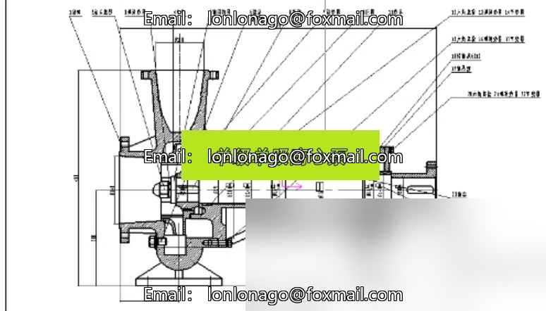

# Heat pump pump design; Petrochemical plant heat pump pump design; Single-stage single-impeller centrifugal pump design; Heat pump pump CA design

## Body

Thermal oil pump design; petrochemical plant thermal oil pump design; single-stage single suckage centrifugal pump design; thermal oil pump designCADFigure Petrochemical Plant Hot Oil PumpCADDrawing, single-stage single-suction centrifugal pumpCADFigure337

The design covers petrochemical plant heat oil pumps, single-stage single-suction centrifugal pump design, heat oil pump CAD figures and installation-related drawings, with visible dimensions and multiple CAD document types.

<!-- AI_ENRICHED -->

## Images

## Payment

Here is a pay link on Stripe ( https://buy.stripe.com/3cs8yP7sY87d0vu9AB ). Please contact me lonlonago@foxmail.com after funding $89, and I will send you a complete data files , thank you!

